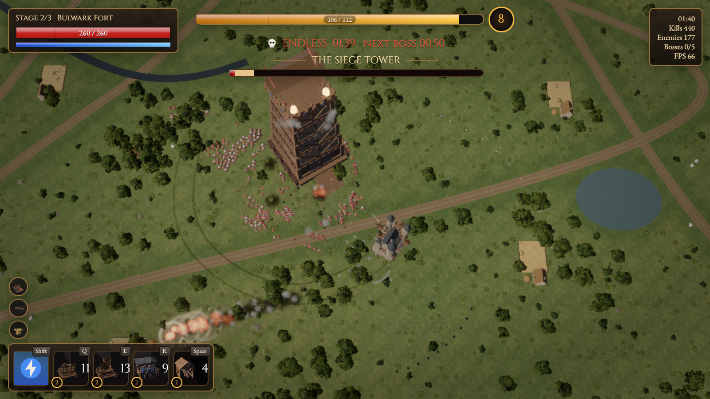
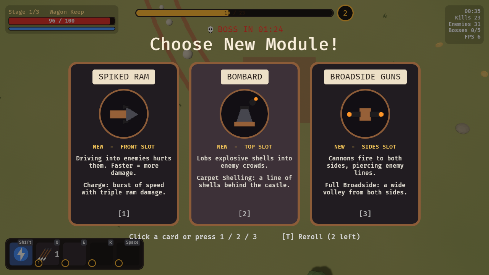
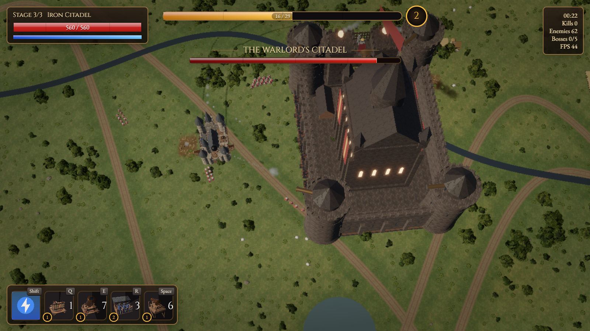

# SiegeCastle

A fast 3D medieval action roguelike made with **Rust + Bevy 0.20**, with a realistic look: a gothic castle of cut stone and slate spires, textured materials, soft shadows and atmospheric light.

Drive a castle on wheels across the countryside, plow through marching armies, and bolt new weapons onto your walls as you level up. Your castle grows through 3 stages. Beat 5 bosses, then survive the endless siege for as long as you can, as enemies grow exponentially in numbers and strength.



| Level-up cards | Grand Citadel vs. the Warlord |
|---|---|
|  |  |

## Run it

You need [Rust](https://rustup.rs) 1.97.1 or newer.

```bash
cargo run --release
```

The first build takes a few minutes because it compiles Bevy. Later builds are quick.

On Linux, install these first (Ubuntu/Debian):

```bash
sudo apt install pkg-config libasound2-dev libudev-dev libwayland-dev libxkbcommon-dev libxkbcommon-x11-0
```

## Controls

| Key | Action |
|---|---|
| WASD / Arrow keys | Steer. The castle turns toward where you steer and rolls forward like a vehicle |
| Shift | Nitro boost (refills over time) |
| Q, E, R, Space | Use the ability of the module in slot 1, 2, 3, 4 |
| 1 / 2 / 3 or click | Pick a level-up card |
| T | Reroll the cards (2 per run) |
| P / Esc | Pause |
| R | Restart (after game over or while paused) |
| F12 | Save a screenshot to `screenshots/` |

## How it plays

**XP and levels.** Enemies drop gold coins. Driving over farms gives a lot of XP and repairs your walls, and scooping up sheep gives a little. Every level-up opens a card choice: even levels offer weapon modules, odd levels offer artifacts.

**The castle grows in 3 stages.** At level 6 and level 14 you choose how it grows:

| Stage | Defense choice | Movement choice | Module slots |
|---|---|---|---|
| 1 | Wagon Keep | | 2 |
| 2 (level 6) | Bulwark Fort: tough, heavy, big magnet | Outrider Fort: fast, more nitro | 3 |
| 3 (level 14) | Iron Citadel | Thunder Citadel | 4 |

Growing fully repairs the castle and blasts nearby enemies away.

**Weapon modules** (6). Each has an automatic attack plus an ability on its key. Picking one again levels it up, to a maximum of level 5.

| Module | Slot | Automatic | Ability |
|---|---|---|---|
| Archer Loft | Top | Archers on a covered hoarding fire arcing volleys | Arrow Storm: arrows rain all around |
| Ballista | Top | Heavy bolts that skewer whole ranks at long range | Bolt Storm: a fan of bolts ahead |
| Bronze Bombard | Top | Explosive shells into crowds | Carpet Shelling: a line of shells behind you |
| Battering Ram | Front | Driving into enemies hurts them, more at speed | Charge: speed burst with triple ram damage |
| Mine Chute | Back | Drops mines as you drive | Minefield: a dozen mines at once |
| Bronze Cannons | Sides | Piercing cannonballs to both sides | Full Broadside: a wide volley each side |

**Artifacts** (stack up to 5 times): Whetstone (damage), Greased Axles (speed), Lodestone (coin magnet), Reinforced Hull (health), Quick Hands (attack speed), Black Powder (explosion size), Hawk Eye (range), Tinker's Kit (ability cooldowns), Herbal Poultice (repair over time), Golden Fleece (XP), Nitro Tank (nitro), Iron Spikes (enemies touching your walls take damage).

**Enemies** march in formations and swarm you up close: footmen, archers who shoot back, knights on horseback, and spiked war carts.

**Bosses** arrive on a countdown (shown under the XP bar). A red arrow next to your castle points to the nearest one.

1. **The Siege Tower** unloads squads of footmen.
2. **Twin War Wagons** keep their distance and fire cannons.
3. **Iron Juggernaut** winds up (red warning line), then charges.
4. **Trebuchet Fortress** lobs boulders. Get out of the red rings.
5. **The Warlord's Citadel** fires cannon volleys, sends knights, and charges.

**Endless siege.** After the Warlord falls there is no more countdown to a finish. Every 30 seconds enemies get about 22% more health, 10% more damage, and spawn 15% faster in bigger groups, and random bosses keep returning. The run ends when your castle falls.

## How it looks

Everything is generated in code, with no art files to download:

- **Gothic castle:** round towers with corbelled parapets and steep slate spires, a great hall with buttresses, lancet windows and a rose window, curtain walls with battlements, a gatehouse with a portcullis, and a clock tower at stage 3. It all rides on a timber-and-iron siege platform.
- **Realistic materials:** cut limestone blocks with mortar, overlapping slate shingles with moss, weathered planks, forged iron with rust, meadow grass, mud, wheat and plaster. Each surface has color, relief (normal map) and roughness/metal maps, tiles seamlessly, and has mipmaps for crisp distance views.
- **Countryside:** trees, firs and bushes built from leaf, needle and grass cards with a generated foliage texture; grass tufts with wildflowers; winding dirt roads with wheel ruts; farmsteads with timber-framed houses and wheat fields; ponds and a river.
- **Weapons:** a bronze cannon on a spoked-wheel carriage, a torsion ballista, archers drawing longbows on a covered hoarding, a bronze mortar, and a covered battering ram.
- **Cards:** velvet-and-gold level-up cards (crimson for weapons, sapphire for artifacts, emerald for castle growth) showing real 3D renders of each item, made in an off-screen studio at startup.
- **Lighting:** a warm late-afternoon sun with soft cascaded shadows, cool sky light, screen-space ambient occlusion, distance haze, bloom on fire, and SMAA anti-aliasing.
- **Effects:** soft smoke, dust and fire sprites painted at startup, flashes of light that briefly light up the ground, shockwave rings, sparks and embers, muzzle blasts, smoke trails behind cannonballs and shells, blood splatter and scorch marks that fade away, and wheel ruts behind the castle.
- **UI:** Cinzel titles and EB Garamond text (both under the SIL Open Font License, see `assets/fonts/`). Leather-and-bronze panels, glossy bars that leave a pale trail when you take damage, a clock-hand sweep on ability cooldowns, a level ring that pops on level-up, cards that rise into place and lift when hovered, and screen edges that flush red when the walls are hit.

## How it moves

- **Castle:** wheels roll with your speed, the body leans into turns, squats when you speed up, rocks and sheds stone chips when hit, and kicks up dust. Flags wave.
- **Weapons:** the ballista, bombard and archers turn to track their target. Barrels slam back when they fire, the ballista bolt vanishes and is winched back in, and the ram log swings as you speed up and brake, then pounds back and forth while charging.
- **Troops:** march with a stride of their own, horses gallop, soldiers hack at your walls, archers recoil as they loose, everyone flinches when hit and gets bowled over by rams and blasts. The fallen topple over and sink away.
- **Bosses:** the Siege Tower drops its drawbridge to let each squad out, the War Wagon drives around you while its turret tracks you, the Juggernaut rears up and spins its drill before charging, the Trebuchet's arm whips over the top on every throw, and the Warlord's twin guns slam back on each volley. Beaten bosses list over and sink in fire and smoke.

## Why it is fast

- **ECS (Entity Component System):** Bevy stores game data in a cache-friendly layout and runs systems in parallel.
- **Parallel troop movement:** every enemy's movement, formation keeping and crowding runs across all CPU cores.
- **Spatial grid:** enemies are sorted into small cells every frame, so targeting, collisions and explosions only check nearby cells.
- **One mesh per unit:** each model is many colored shapes merged into a single mesh, and nearly everything shares one material, so thousands of units draw in a few batched calls. Static scenery is merged into a few big chunks.
- **Caps:** at most 2200 troops and 900 coins at once. In endless mode enemies keep getting stronger past the cap, and extra XP goes straight to you.

## Code layout

```
src/
  main.rs         app setup, game states, frame ordering
  art.rs          coordinates, castle mount points, terrain meshes
  models.rs       every 3D model (castle, troops, bosses, farms, trees)
  texgen.rs       realistic stone/slate/wood/iron/grass textures, made in code
  icons.rs        fallback UI icons
  previews.rs     3D portraits of weapons, artifacts and castles for the cards
  assets.rs       builds models and materials once at startup
  items.rs        modules, artifacts, castle stages, stat math
  player.rs       castle driving, nitro, health, looks, growth
  modules.rs      weapon auto-attacks and abilities
  enemy.rs        troops, formations, the five bosses
  director.rs     spawning, boss countdown, endless scaling
  combat.rs       shots, explosions, mines, coins
  vfx.rs          smoke, fire, sparks, flashes, debris and ground marks
  anim.rs         moving parts, troop and boss animation, corpses and wrecks
  progression.rs  XP, levels, card choices
  world.rs        terrain, forests, water, farms, sheep, camera, sun
  hud.rs          on-screen bars, slots, banners, end screens
  grid.rs         spatial grid for fast "who is near me?" checks
  debug.rs        autopilot and screenshot helpers for testing
```

## Testing helpers

All off by default. For example:

```bash
SIEGE_AUTOPILOT=1 SIEGE_LOG=1 SIEGE_SHOTS=30,120 SIEGE_EXIT_AFTER=150 cargo run --release
```

- `SIEGE_AUTOPILOT=1`: drives, uses abilities and picks cards by itself
- `SIEGE_SHOTS=30,120`: screenshots at these run times (seconds); `SIEGE_SHOT_CHOICE=1` also captures a card screen
- `SIEGE_SHOT_DIR=path`: where screenshots go
- `SIEGE_EXIT_AFTER=150`: quit after this many seconds
- `SIEGE_SPEED=2`: run the game clock faster
- `SIEGE_LOG=1`: print a status line every 5 seconds
- `SIEGE_START_LEVEL=8`: start with that many levels' worth of XP
- `SIEGE_BOSS_IN=10`: first boss after this many seconds
- `SIEGE_ENDLESS=1`: start in endless mode
- `SIEGE_GALLERY=1`: spawn all five bosses at once
- `SIEGE_GOD=1`: castle cannot be destroyed
- `SIEGE_LOWRES=1`: small window, no shadows or ambient occlusion, for quick tests on machines without a GPU

Inspired by the "castle on wheels" idea from Wanderburg and by gothic castle architecture. All code, models, textures, names and text in this project are original. Fonts: Cinzel and EB Garamond, SIL Open Font License 1.1.
